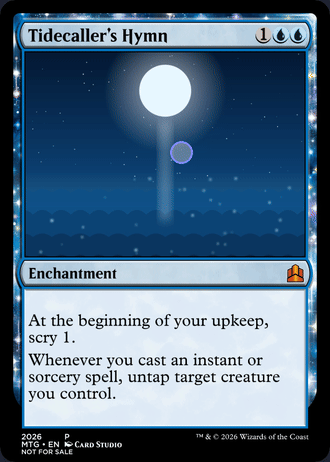
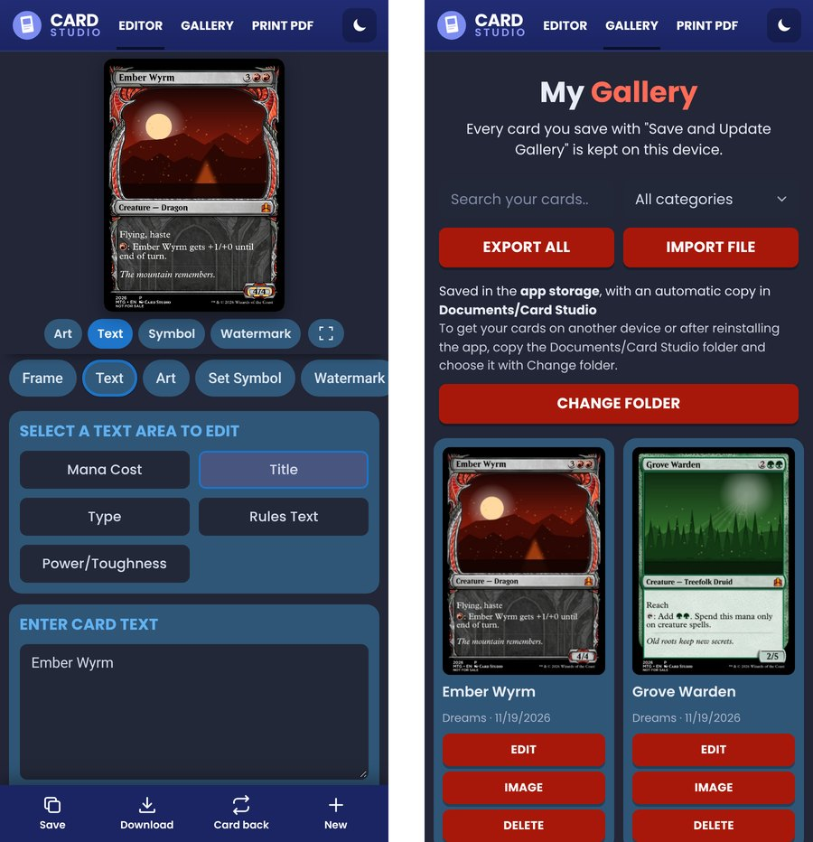

<p align="center">
  
</p>

<h1 align="center">Card Studio</h1>

<p align="center">
  <b>Design custom Magic cards on your computer or phone, even without internet.</b><br>
  Hundreds of frames, full control over text and art, a gallery saved as real files, and print-ready sheets. No account needed.
</p>

<p align="center">
  <a href="https://github.com/Vagharlix/MTGCardBuilder/releases/latest"></a>
  <a href="https://github.com/Vagharlix/MTGCardBuilder/releases"></a>
  <a href="#install-in-30-seconds"></a>
  <a href="#works-offline"></a>
  <a href="https://github.com/Vagharlix/MTGCardBuilder/actions/workflows/build.yml"></a>
</p>

<p align="center">
  <a href="#install-in-30-seconds">Install</a> ·
  <a href="#features">Features</a> ·
  <a href="#make-your-first-card">First card</a> ·
  <a href="#faq">FAQ</a> ·
  <a href="https://github.com/Vagharlix/MTGCardBuilder/issues">Report a bug</a>
</p>

<p align="center">
  
</p>

## Install in 30 seconds

| System | Download |
| --- | --- |
| **Android** | [**Card-Studio-main-arm64.apk**](https://github.com/Vagharlix/MTGCardBuilder/releases/latest/download/Card-Studio-main-arm64.apk), then open it (allow installing unknown apps if your phone asks) |
| **Windows** | `Card.Studio_x.y.z_x64-setup.exe` from the [latest release](https://github.com/Vagharlix/MTGCardBuilder/releases/latest) |
| **macOS** (Apple Silicon) | `Card.Studio_x.y.z_aarch64.dmg` from the [latest release](https://github.com/Vagharlix/MTGCardBuilder/releases/latest) |
| **Linux** | `.AppImage` (any distribution), `.deb` or `.rpm` from the [latest release](https://github.com/Vagharlix/MTGCardBuilder/releases/latest) |

To update, install the new version over the old one: your cards stay where they are.

## Features

### Hundreds of frames

<p align="center">
  
</p>

382 frame packs, sorted into groups and searchable. Stack frames as layers, reorder them, change their opacity and position, and use masks to apply a frame to only part of the card. You can also add your own frame images.

Around the frame: 291 set symbols in each rarity, a searchable watermark library, 85 card fonts, and mana and formatting codes for the rules text.

### Edit right on the card

<p align="center">
  
</p>

Drag the art, any text box, the set symbol or the watermark with your mouse or finger. Pinch to resize. Every position and size also has a slider for fine adjustments.

### Made for phones too

<p align="center">
  
</p>

On a phone, the card stays pinned at the top while you scroll through the settings. On a wide screen (tablet, unfolded foldable, computer), the settings sit next to the card.

### Your gallery, your files

<p align="center">
  
</p>

Every saved card is a real file in **Documents/Card Studio**: a `.cardconjurer` file (the card itself, editable at any time) and a `.jpg` image.

- **Reopen and edit** any card from the gallery, then save it under the same name.
- **Move to another device**: copy the folder, then pick it with *Change folder*. All your cards come back.
- **Nothing gets lost**: on Android, every card is also copied to Documents, which stays even if you uninstall the app.
- **Sort and find**: categories, search, presets made from your own cards, single-file export and import.

### Print your cards

<p align="center">
  
</p>

Pick cards and how many copies of each: Card Studio builds an A4 or Letter PDF with cards at **63×88 mm**, cut marks and optional bleed. Single cards export as 2010×2814 px images (800 DPI at real size).

### Works offline

Everything ships inside the app: frames, fonts, symbols. No account, no ads, nothing sent anywhere. Only two optional features use the internet: importing a real card from Scryfall and loading a set symbol from an online source.

### Everything else

- Card backs: start the back of the card you are working on in one click.
- Collector info: number, rarity, set, language, artist, year, serial number.
- Rotate the card for sideways layouts.
- Light and dark themes.
- The card you are working on is saved automatically.

## Make your first card

1. **Frame**: pick a group and a pack, click a frame, then *Add Frame to Card*.
2. **Text**: pick a text box (Title, Mana Cost, Type, Rules Text…) and type. Codes like `{w}` `{u}` `{b}` `{r}` `{g}` `{t}` insert symbols, `{flavor}` starts the flavor text.
3. **Art**: import your illustration, then drag it on the card.
4. **Save and Update Gallery** to keep it, **Download** to get the image.

The **Tutorial** tab in the app explains every option.

## FAQ

<details>
<summary><b>Windows says "Windows protected your PC"</b></summary>

The app is not signed with a paid certificate. Click *More info*, then *Run anyway*.
</details>

<details>
<summary><b>macOS will not open the app</b></summary>

The first time, right-click the app and choose *Open*. If macOS still refuses:

```bash
xattr -cr "/Applications/Card Studio.app"
```
</details>

<details>
<summary><b>How do I run the Linux AppImage?</b></summary>

Make it executable, then double-click it:

```bash
chmod +x Card.Studio_*.AppImage
```

On Debian or Ubuntu you can install the `.deb` instead (`sudo apt install ./Card.Studio_*.deb`), on Fedora or openSUSE the `.rpm` (`sudo dnf install ./Card.Studio-*.rpm`).
</details>

<details>
<summary><b>Where are my cards, and how do I move them to another device?</b></summary>

In **Documents/Card Studio** (on Android: inside the app, with a copy in Documents/Card Studio). The *Gallery* tab shows the exact location. Copy that folder to the other device and pick it with *Change folder*, or import its files with *Import File*. *Export All* also creates a single backup file.
</details>

<details>
<summary><b>What about iPhone, iPad or Intel Macs?</b></summary>

Not available for now.
</details>

## Report a bug or suggest an idea

Open an [issue](https://github.com/Vagharlix/MTGCardBuilder/issues) with a screenshot and your version (shown at the bottom of the app).

## Built with AI

Card Studio was developed with the help of AI (Claude Code): the code, the tests and the illustrations of the demo cards shown above, which were made for this README.

## Credits

- Inspired by **[mtgcardbuilder.com](https://mtgcardbuilder.com)**.
- Built with **[Tauri](https://tauri.app)**.

---

<sub>For personal use only. Card Studio is not affiliated with, sponsored or endorsed by Wizards of the Coast. Magic: The Gathering is a trademark of Wizards of the Coast LLC.</sub>
