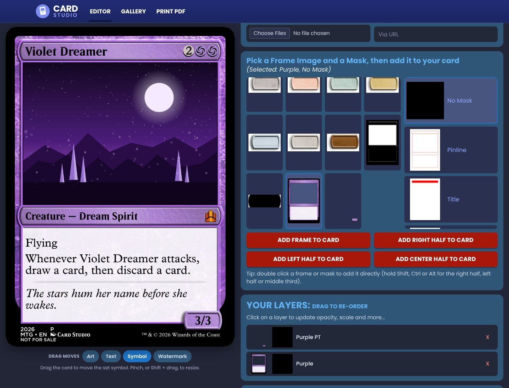
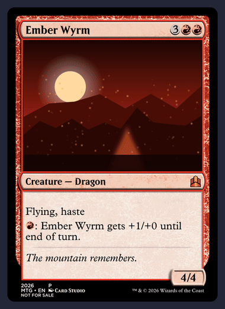
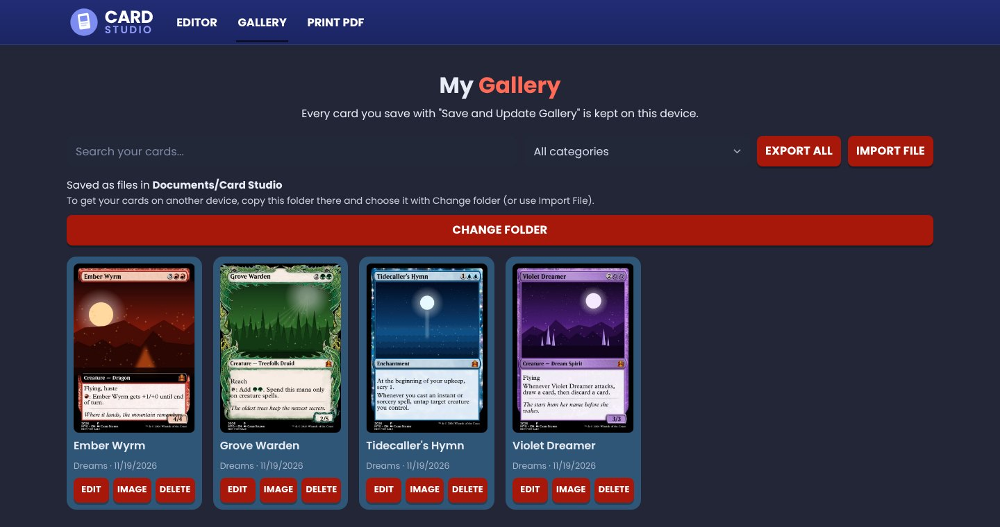
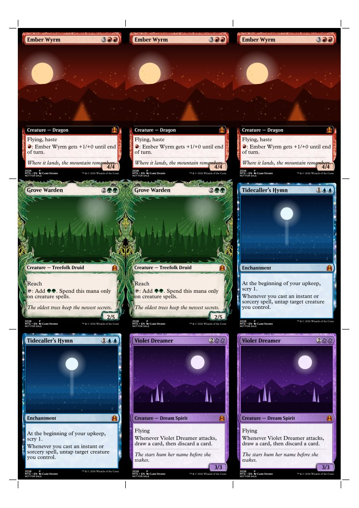

<p align="center">
  
</p>

<h1 align="center">Card Studio</h1>

<p align="center">
  <b>Crée tes cartes Magic personnalisées sur PC et Android, même sans Internet.</b><br>
  L'éditeur de mtgcardbuilder.com en vraie appli : 382 packs de cadres, aucun compte, et tes cartes restent chez toi.
</p>

<p align="center">
  <a href="https://github.com/Vagharlix/MTGCardBuilder/releases/latest"></a>
  <a href="https://github.com/Vagharlix/MTGCardBuilder/releases"></a>
  <a href="#-installer-en-30-secondes"></a>
  <a href="#-100--hors-ligne"></a>
  <a href="https://github.com/Vagharlix/MTGCardBuilder/actions/workflows/build.yml"></a>
</p>

<p align="center">
  <a href="#-installer-en-30-secondes">Installer</a> ·
  <a href="#fonctionnalités">Fonctionnalités</a> ·
  <a href="#card-studio-ou-le-site-">Comparaison</a> ·
  <a href="#créer-ta-première-carte">Première carte</a> ·
  <a href="#questions-fréquentes">FAQ</a> ·
  <a href="https://github.com/Vagharlix/MTGCardBuilder/issues">Signaler un bug</a>
</p>

<p align="center">
  
</p>

## ⚡ Installer en 30 secondes

| Système | Télécharger |
| --- | --- |
| 🤖 **Android** | [**Card-Studio-main-arm64.apk**](https://github.com/Vagharlix/MTGCardBuilder/releases/latest/download/Card-Studio-main-arm64.apk), puis ouvre-le (autorise l'installation d'applis inconnues si ton téléphone le demande) |
| 🪟 **Windows** | `Card.Studio_x.y.z_x64-setup.exe` sur la [page de la dernière version](https://github.com/Vagharlix/MTGCardBuilder/releases/latest) |
| 🍎 **macOS** (Apple Silicon) | `Card.Studio_x.y.z_aarch64.dmg` sur la [page de la dernière version](https://github.com/Vagharlix/MTGCardBuilder/releases/latest) |
| 🐧 **Linux** | `.AppImage` (toutes distributions), `.deb` ou `.rpm` sur la [page de la dernière version](https://github.com/Vagharlix/MTGCardBuilder/releases/latest) |

Pour mettre à jour, installe la nouvelle version par-dessus l'ancienne : tes cartes restent.

## Fonctionnalités

### 🖼️ Tous les cadres du site, 382 packs

<p align="center">
  
</p>

Regular, Borderless, Extended Art, Showcase, Universes Beyond, Sagas, Planeswalkers, Transform, Stations, Rooms, Omens… Les mêmes packs que mtgcardbuilder.com, **cadres violets compris** (« Purple », « Purple PT », « Purple Crown »), avec leurs masques pour ne colorer qu'une partie de la carte.

Et autour du cadre : 291 symboles d'extension, une bibliothèque de filigranes avec recherche (guildes, clans, écoles, extensions…), 85 polices et les codes de mana du site, dont `{purple}`.

### ✋ Modifie directement sur la carte

<p align="center">
  
</p>

Fais glisser l'illustration, le texte, le symbole d'extension ou le filigrane du bout du doigt. Pince pour agrandir. Chaque position et chaque taille a aussi son curseur pour les réglages fins.

### 📱 Aussi confortable sur téléphone

<p align="center">
  
</p>

La carte reste épinglée en haut pendant que tu fais défiler les réglages. Sur un écran large (tablette, téléphone pliable ouvert, PC), les réglages passent à côté de la carte.

### 💾 Ta galerie t'appartient

<p align="center">
  
</p>

Chaque carte enregistrée est un vrai fichier dans **Documents/Card Studio** : un `.cardconjurer` (la carte, modifiable à tout moment) et son image `.jpg`.

- **Rouvre et modifie** n'importe quelle carte de la galerie, puis enregistre-la sous le même nom.
- **Change d'appareil** : copie le dossier, puis choisis-le dans *Change folder*. Toutes tes cartes réapparaissent.
- **Rien ne se perd** : sur Android, chaque carte est aussi copiée dans Documents, qui reste même si tu désinstalles l'appli.

### 🖨️ Imprime tes planches

<p align="center">
  
</p>

Choisis les cartes et le nombre de copies : Card Studio fait un PDF A4 ou Letter, cartes à **63×88 mm**, avec traits de coupe et fond perdu. Les images exportées font 2010×2814 px (800 DPI à taille réelle).

### ✈️ 100 % hors ligne

Tout est dans l'appli : cadres, polices, symboles. Pas de compte, pas de pub, rien n'est envoyé nulle part. Seules deux options facultatives utilisent Internet : importer une vraie carte depuis Scryfall et charger un symbole d'extension depuis une source en ligne.

## Card Studio ou le site ?

|  | **Card Studio** | mtgcardbuilder.com |
| --- | :---: | :---: |
| Fonctionne sans Internet | ✅ | ❌ |
| Compte obligatoire | Non | Oui |
| Appli Android, Windows, macOS, Linux | ✅ | ❌ (site web) |
| Mêmes cadres, violets compris | ✅ 382 packs | ✅ |
| Où sont tes cartes | Sur ton appareil, en fichiers | Dans ton compte en ligne |
| Impression | Planche PDF à imprimer chez toi | Commande en ligne (MTGProxy.com) |
| Offres premium, outils IA | Rien de tout ça, tout est inclus | Oui |

Card Studio ne remplace pas le site : il reprend son éditeur pour l'utiliser n'importe où, sans connexion et sans compte.

## Créer ta première carte

1. **Frame** : choisis un groupe et un pack, clique sur un cadre puis *Add Frame to Card*. Ajoute la case de force/endurance de la même façon.
2. **Text** : choisis une zone (Title, Mana Cost, Type, Rules Text…) et tape ton texte. Les codes `{w}` `{u}` `{b}` `{r}` `{g}` `{purple}` `{t}` donnent les symboles, `{flavor}` passe au texte d'ambiance.
3. **Art** : importe ton illustration, puis fais-la glisser sur la carte.
4. **Save and Update Gallery** pour la garder, **Download** pour l'image PNG.

L'onglet **Tutorial** de l'appli détaille chaque option.

## Questions fréquentes

<details>
<summary><b>Windows affiche « Windows a protégé votre ordinateur »</b></summary>

L'appli n'est pas signée avec un certificat payant. Clique sur *Informations complémentaires*, puis *Exécuter quand même*.
</details>

<details>
<summary><b>macOS refuse d'ouvrir l'appli</b></summary>

La première fois, fais un clic droit sur l'appli puis *Ouvrir*. Si macOS refuse encore :

```bash
xattr -cr "/Applications/Card Studio.app"
```
</details>

<details>
<summary><b>Linux : comment lancer l'AppImage ?</b></summary>

Rends-la exécutable, puis double-clique dessus :

```bash
chmod +x Card.Studio_*.AppImage
```

Sur Debian/Ubuntu tu peux aussi installer le `.deb` (`sudo apt install ./Card.Studio_*.deb`), sur Fedora/openSUSE le `.rpm` (`sudo dnf install ./Card.Studio-*.rpm`).
</details>

<details>
<summary><b>Où sont mes cartes ? Comment les mettre sur un autre appareil ?</b></summary>

Dans **Documents/Card Studio** (sur Android : dans l'appli, avec une copie dans Documents/Card Studio). L'onglet *Gallery* indique l'emplacement exact. Copie ce dossier sur l'autre appareil et choisis-le avec *Change folder*, ou importe ses fichiers avec *Import File*. *Export All* crée aussi un fichier de sauvegarde unique.
</details>

<details>
<summary><b>Et l'iPhone, l'iPad ou un Mac Intel ?</b></summary>

Pas de version pour l'instant.
</details>

## Signaler un bug, proposer une idée

Ouvre une [issue](https://github.com/Vagharlix/MTGCardBuilder/issues) avec une capture d'écran et ta version (affichée en bas de l'appli).

## Remerciements

- **Card Conjurer**, le moteur de rendu open source sur lequel reposent Card Studio et mtgcardbuilder.com.
- **[mtgcardbuilder.com](https://mtgcardbuilder.com)** pour ses cadres, dont les cadres violets.
- **[Tauri](https://tauri.app)**, qui fait de l'éditeur une appli légère sur chaque système.

Card Studio a été développé avec l'aide d'une IA (Claude Code). Les illustrations des cartes de démonstration ont été dessinées pour ce README.

---

<sub>Usage personnel uniquement. Card Studio n'est ni affilié à Wizards of the Coast, ni sponsorisé, ni approuvé par eux. Magic: The Gathering est une marque de Wizards of the Coast LLC.</sub>
